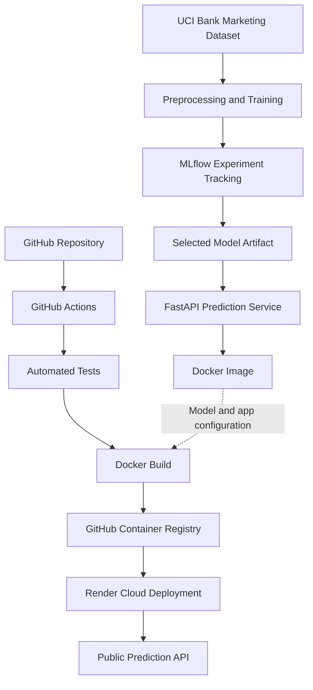

# Bank Marketing Prediction Service — End-to-End MLOps

An end-to-end machine learning prediction service for estimating whether a bank customer will subscribe to a term deposit.

The project demonstrates the complete ML engineering workflow, from data preprocessing and experiment tracking to REST API development, containerization, automated testing, and cloud deployment.

**Tech Stack:** Python · Scikit-learn · XGBoost · MLflow · FastAPI · Docker · GitHub Actions · GitHub Container Registry · Render

**Live API:** [https://bank-marketing-api-5cby.onrender.com/](https://bank-marketing-api-5cby.onrender.com/)

**API Documentation:** [https://bank-marketing-api-5cby.onrender.com/docs](https://bank-marketing-api-5cby.onrender.com/docs)

## 1. Project Overview

The objective is to predict the likelihood of a customer subscribing to a term deposit using demographic, campaign, and economic features.

The project uses the UCI Bank Marketing `bank-additional-full` dataset, containing 41,188 records.

Three classification algorithms were evaluated:

- Logistic Regression
- Random Forest
- XGBoost

The `duration` feature was excluded to prevent using information unavailable before a marketing call.

A chronological train/validation/test split was used to better simulate predictions on future observations.

## 2. System Architecture



## 3. Machine Learning

### Data preprocessing

The preprocessing pipeline uses Scikit-learn's `ColumnTransformer` and `Pipeline`.

- Numeric features: median imputation and standardization.
- Categorical features: most-frequent imputation and one-hot encoding.
- Unknown categories: handled through `OneHotEncoder(handle_unknown="ignore")`.

Preprocessing is fitted only on training data to prevent leakage.

### Data splitting

| Dataset | Proportion |
|---|---:|
| Training | 70% |
| Validation | 15% |
| Test | 15% |

### Model evaluation

Models were compared using accuracy, F1-score, ROC-AUC, and average precision (PR-AUC).

**Selected model:** [Insert model name]

**Final held-out test performance:**

| Metric | Value |
|---|---:|
| Accuracy | [0.7540055025084965] |
| Precision | [0.7565947242206235] |
| Recall | [0.5311447811447811] |
| F1-score | [0.6241345202769535] |
| ROC-AUC | [0.8160943181486173] |
| PR-AUC | [0.7549803236966695] |

The final test set was reserved for evaluation and was not used for model selection or hyperparameter tuning.

## 4. MLflow Experiment Tracking

MLflow is used to track model configurations, evaluation metrics, and trained pipeline artifacts.

Each training run records the model parameters, validation metrics, and complete fitted preprocessing/classification pipeline.

The selected model is exported as an MLflow artifact and packaged into the inference Docker image.

## 5. REST API

The prediction service is implemented using FastAPI and Pydantic.

### Endpoints

| Method | Endpoint | Description |
|---|---|---|
| GET | `/health` | Service health check |
| POST | `/predict` | Generate a prediction |
| GET | `/docs` | Interactive Swagger documentation |

### Example response

```json
{
  "prediction": 0,
  "subscription_probability": 0.123
}
```

## 6. Local Deployment with Docker

Pull the published image:

```bash
docker pull ghcr.io/anushaihalapathirana/bank-marketing-mlops:latest
```

Run the container:

```bash
docker run --rm -p 8001:8000 \
  ghcr.io/anushaihalapathirana/bank-marketing-mlops:latest
```

The API will be accessible at:

`http://localhost:8001/docs`

The published image supports both AMD64 and ARM64 architectures.

## 7. Model Training and Reproducibility

Install Python 3.10 and create a virtual environment.

```bash
python3.10 -m venv .venv
source .venv/bin/activate
```

Install the training dependencies using the project's recorded environment requirements.

Download `bank-additional-full.csv` from the [UCI Bank Marketing dataset](https://archive.ics.uci.edu/dataset/222/bank+marketing) and place it under `data/raw/`.

Train the models:

```bash
python src/train.py
```

Evaluate the selected model:

```bash
export MODEL_URI="models:/YOUR_MODEL_ID"
python src/evaluate.py
```

This requires the selected model artifact to be accessible through the configured local MLflow store.

## 8. Automated Testing

The project uses pytest and FastAPI's TestClient.

Tests cover successful predictions, request validation, missing features, unexpected features, and health checks.

Run the tests:

```bash
python -m pip install -r requirements-ci.txt
python -m pytest tests/ -v
```

API tests use a mock model so that they can run independently of the locally trained MLflow artifact.

## 9. CI/CD Pipeline

GitHub Actions automatically executes the following workflow on changes to the main branch:

1. Install dependencies and execute automated API tests.
2. Build Docker images for AMD64 and ARM64.
3. Publish versioned images to GitHub Container Registry.
4. Trigger deployment to Render using a deploy hook.

Docker images receive both a `latest` tag and an immutable Git commit SHA tag for traceability.

Model artifacts are stored separately from the Git source repository.

## 10. Limitations and Future Improvements

This project demonstrates a deployable ML prediction service rather than a fully managed production ML platform.

Current limitations include:

- Evaluation on a historical dataset rather than live campaign data.
- No implemented production data-drift monitoring.
- No automated model retraining.
- No dedicated probability calibration or business-cost threshold optimization.
- No production-grade API authentication or rate limiting.

Future work could include model monitoring, drift detection, calibration analysis, and automated retraining.

## 11. Dataset Reference

Dataset: [UCI Machine Learning Repository — Bank Marketing](https://archive.ics.uci.edu/dataset/222/bank+marketing)
